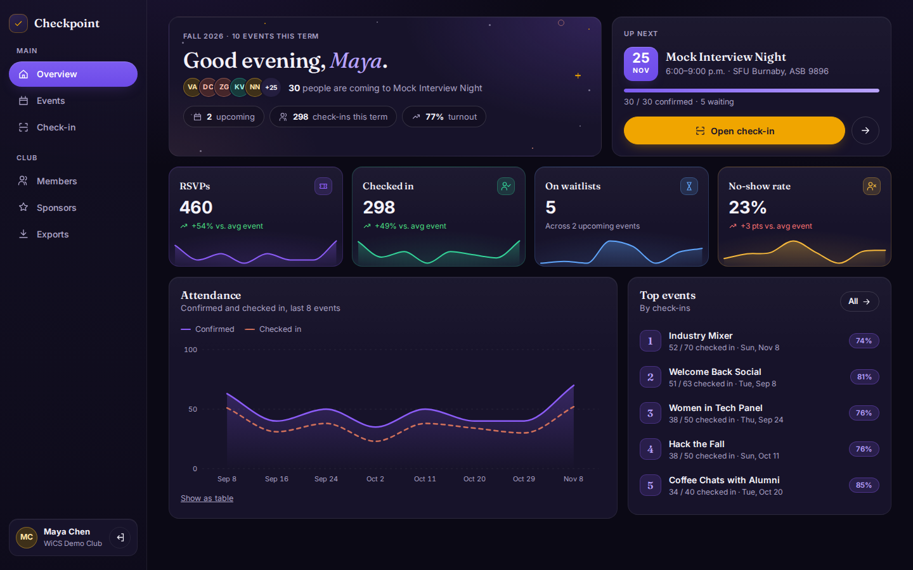
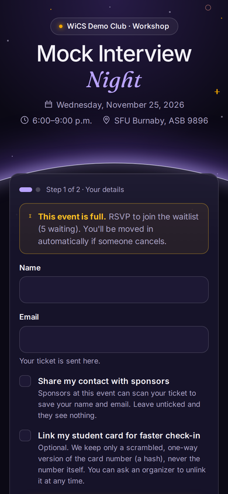
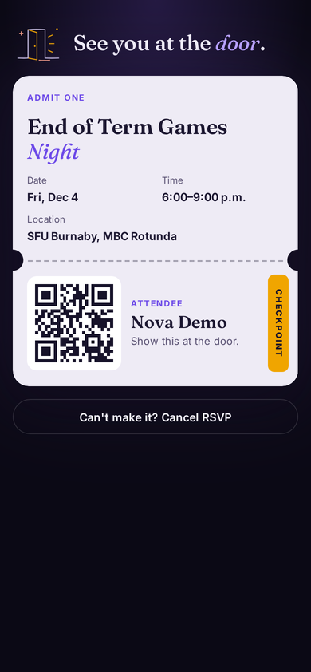
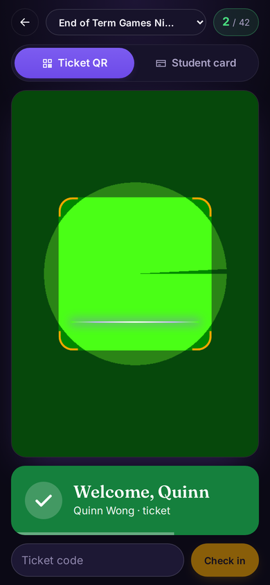
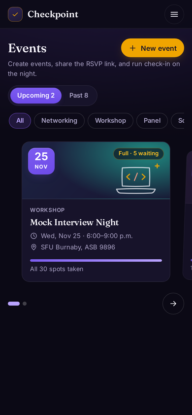
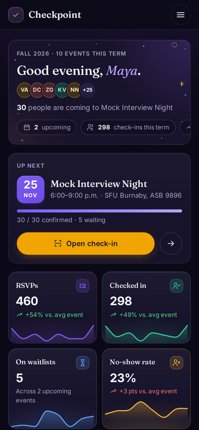
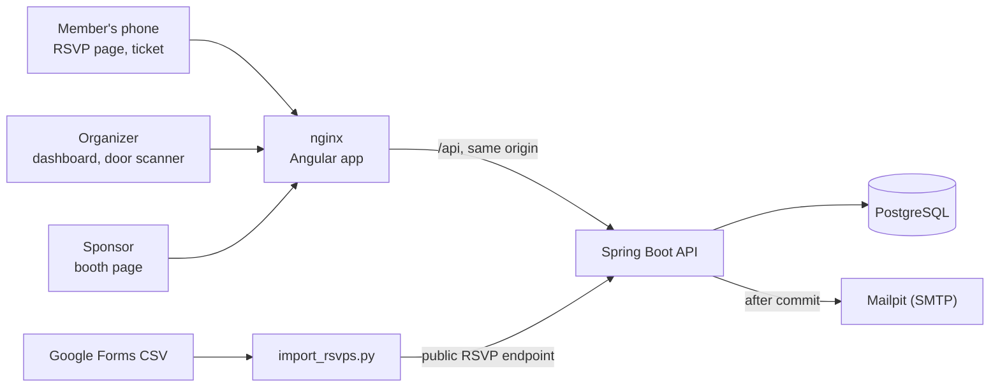
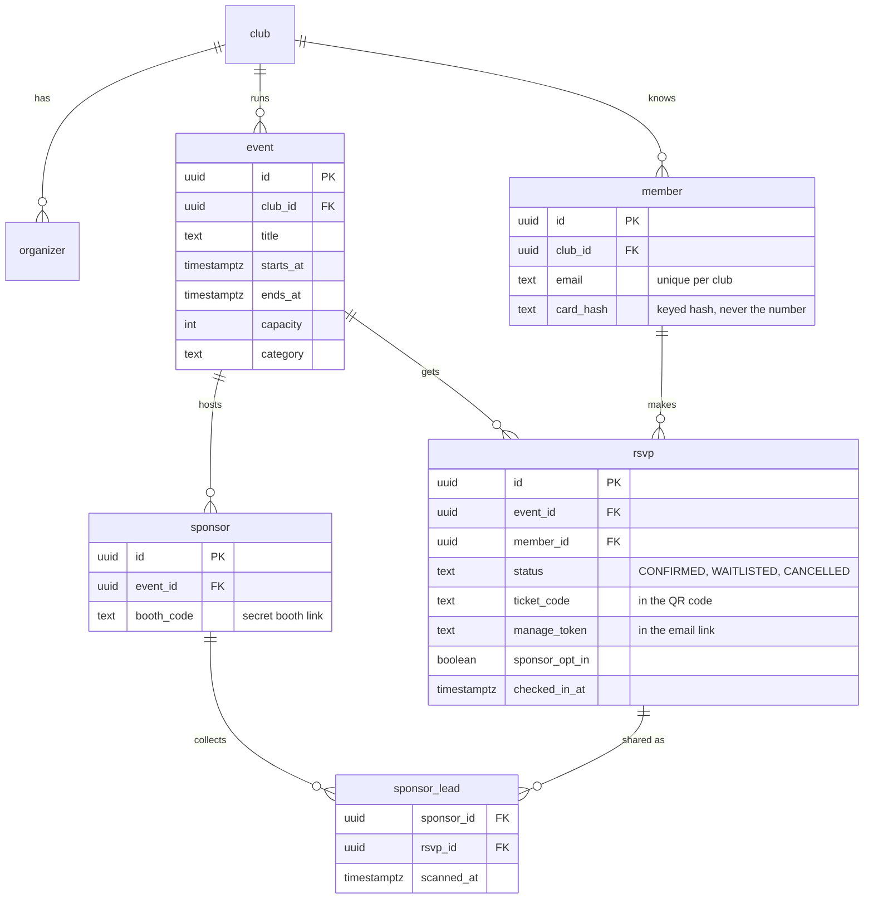

# Checkpoint

RSVPs, waitlists and door check-in for student clubs, with attendance history that lasts beyond one event.

[](https://github.com/manjari19/checkpoint/actions/workflows/ci.yml)

<p>
  
  &nbsp;
  
</p>

Built for SFU Women in Computing Science (WiCS), to be used for real at Networking Night in January 2027.

## The problem

Our WiCS exec team noted that check-in was done by manually going through an Excel file. A UBC club
we talked to used a card scanner at the door. Tools like Luma handle RSVPs for one event, but they
don't keep a club's attendance history across events, which is what you need to show sponsors and
funding committees who actually comes.

Checkpoint covers the whole loop: a public RSVP page with a fair waitlist, an emailed ticket, a phone
scanner at the door for ticket QR codes and student cards, sponsor contact collection that members opt
into, and member attendance history per term.

## Features

| | |
|---|---|
|  | **Tickets and waitlist.** RSVP while seats last, then join the waitlist and see your place in line. When someone cancels, the next person is promoted automatically and emailed their QR code. The ticket page refreshes itself, so the "Checked in" stamp lands while you stand at the door. |
|  | **Door scanner.** Any organizer's phone scans ticket QR codes or student card barcodes (Codabar, Code 128, Code 39). Green "Welcome", amber "Already checked in at 6:42 p.m.", red "Not on the list". A welcome clears itself after 2 seconds, ready for the next person. |
|  | **Organizer dashboard.** Events, live seat counts, arrivals over time, CSV exports, members with attendance rates per term, and sponsors with private booth links. On phones it becomes swipeable cards and bottom sheets. |
|  | **Club history.** RSVPs, check-ins and no-show rates by term, so the club can see which events work. A Google Forms import brings in RSVPs collected before Checkpoint. |

## Quick start

You need Docker and Git. Java, Node and Python all run inside containers.

```bash
git clone https://github.com/manjari19/checkpoint.git && cd checkpoint
scripts/setup.sh
```

Then open http://localhost:4300.

| Login | Email | Password |
|---|---|---|
| Demo club (120 made-up members, a term of events) | `demo@checkpoint.local` | `checkpoint-demo` |
| Empty club | `organizer@checkpoint.local` | `checkpoint-demo` |

Every email the app sends is caught by Mailpit at http://localhost:8025. The API docs are at
http://localhost:8180/swagger-ui.html. Ports avoid the common ones (5432, 6379, 8000, 8080) so the
stack can run next to other projects.

Other scripts:

```bash
scripts/test-backend.sh                  # backend tests (Testcontainers starts PostgreSQL)
scripts/frontend.sh test                 # frontend unit tests
scripts/test-scripts.sh                  # Python script tests
scripts/import-rsvps.sh --event <id> scripts/samples/google-forms-rsvps.csv --dry-run
scripts/demo-data.sh remove              # delete the demo club
scripts/phone-https.sh                   # HTTPS on your Wi-Fi, so a phone can use its camera
```

## Architecture



nginx serves the Angular app and forwards `/api` to the API, so the browser sees one origin and the
session cookie needs no CORS. Flyway owns the schema; Hibernate only validates it.



## Engineering notes

### Keeping the waitlist correct under concurrency

Seats are counted and handed out inside one transaction that first locks the event's row
(`@Lock(PESSIMISTIC_WRITE)`, which PostgreSQL runs as `SELECT ... FOR NO KEY UPDATE`). An RSVP locks the
event, counts confirmed seats, and inserts the RSVP as confirmed or waitlisted. A cancellation locks the
same event row, cancels, and promotes the next people in line in the same transaction. Two requests for
one event take turns; requests for different events don't wait for each other. The promotion method is
marked `Propagation.MANDATORY`, so calling it without the caller's transaction (and lock) fails loudly.
Emails are sent only after the transaction commits, so nobody is told about a seat that was rolled back.

To check that the lock matters, I removed it and ran the concurrency tests. These are the numbers from
those runs, on my laptop, next to what the tests require with the lock in place:

| Scenario | Without the event lock | With the lock |
|---|---|---|
| 40 simultaneous RSVPs for 10 seats | 19 to 38 confirmed, varying run to run | 10 confirmed, 30 waitlisted |
| 15 simultaneous cancellations, 20 seats full, 25 waiting | 7 confirmed afterwards | 20 confirmed, the first 15 in line promoted |
| Cancellations racing new RSVPs, 5 seats | 6 confirmed | 5 confirmed, freed seats go to the waitlist first |

The tests start the requests on separate threads, release them at the same instant, and run against a
real PostgreSQL in Testcontainers, not an in-memory database. One detail found along the way: in
PostgreSQL, `FOR UPDATE` on a query that joins tables locks the rows of every joined table, so the RSVP
lookup used during cancellation deliberately doesn't join the event.

I chose a row lock over optimistic versioning or SERIALIZABLE isolation because conflicts are the normal
case here (everyone RSVPs in the first minute after the link goes out), and retries would make people
wait longer than a short queue on one row.

### The CSRF test that only failed in CI

All 77 backend tests passed locally, but CI failed one: the test that checks the server hands out the
`XSRF-TOKEN` cookie. The order of test classes was the clue. Maven runs them in the order the file
system lists them, which differs between my machine and GitHub's runners. I reproduced it locally with
`-Dsurefire.runOrder=reversealphabetical`, then narrowed it down to one earlier test class.

The cause was a test helper. Spring Security's `csrf()` request helper doesn't just add a token to one
request: it replaces the CSRF token repository inside the application's real `CsrfFilter`. All
integration tests share one cached application context, so after the first test that used the helper,
the server stopped issuing the cookie for the rest of the run. Production was never affected.

The fix: tests now send a real double-submit token (the same value in the cookie and the
`X-XSRF-TOKEN` header, exactly like the Angular app), and every integration test checks afterwards that
the filter still uses the cookie repository, so the mistake can't come back in any test order. The
suite then passed in default, alphabetical, reverse and three random orders.

### Privacy

- **Student cards.** Card numbers are stored only as an HMAC-SHA256 of the number with a server-side
  secret key (`CARD_HASH_KEY`). Checkpoint can tell whether a scanned card matches, but can't recover the
  number. Linking a card is optional, needs explicit consent on the RSVP form, and an organizer can
  unlink it. The Google Forms import never imports card numbers.
- **Two secrets per RSVP.** The QR code holds a `ticket_code`, which lets staff and sponsors identify a
  ticket but not change it. The email link holds a separate `manage_token`, the only thing that can
  cancel. A photo of someone's QR code can't be used to cancel their seat.
- **Sponsors only get what members agreed to.** Sharing contact details with sponsors is opt-in per
  RSVP. A sponsor scanning a ticket of someone who didn't opt in learns nothing, not even their name.
- **Demo data is made up.** Names are invented, emails use example.com, and card numbers are fake
  (29999000000001 and up).

## Testing

| Suite | Tests | Runs in |
|---|---|---|
| Backend: unit and integration (JUnit 5, Mockito, Testcontainers) | 77 | `scripts/test-backend.sh`, CI |
| Frontend: unit (Vitest) | 60 | `scripts/frontend.sh test`, CI |
| Google Forms import (unittest) | 11 | `scripts/test-scripts.sh`, CI |
| Layout check (Playwright): no sideways scrolling, nothing cut off, no overlapping text | 18 pages at 1440, 768, 390 and 360px | `scripts/screenshots.sh` |

## Tech stack

- **Backend:** Java 21, Spring Boot 3.5 (Web, Data JPA, Validation, Security), PostgreSQL 17, Flyway,
  springdoc OpenAPI, virtual threads.
- **Frontend:** Angular 22 with signals and standalone components, TypeScript, ZXing for barcode
  scanning in the browser (works in iOS Safari, which has no built-in barcode detector).
- **Tooling:** Docker Compose, GitHub Actions, Mailpit, Playwright for the layout check, Python
  standard library for the import script.

## What I'd add next

- **Transactional outbox for emails.** Emails are sent after the transaction commits. If the server
  stopped between the commit and the send, that email would be lost. Writing emails to an outbox table in
  the same transaction and sending them from a worker would make delivery reliable.
- **Deployment.** One small container host with managed PostgreSQL, HTTPS, and real secrets for
  `CARD_HASH_KEY` and the organizer password, plus a real mail provider instead of Mailpit.
- **Data retention.** Automatically delete sponsor contacts and unlinked members after a set time.
